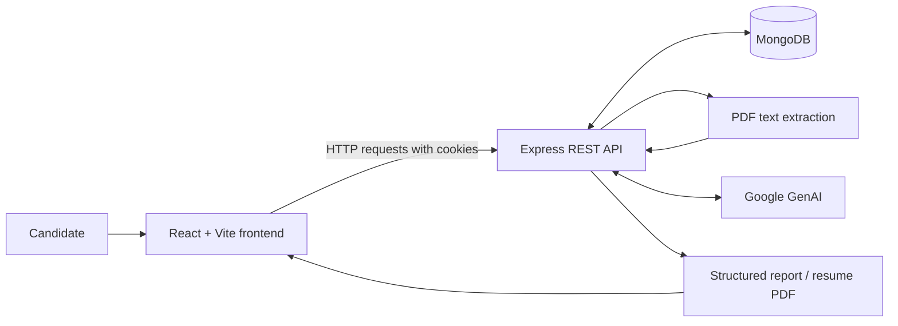

<div align="center">
  <h1>PrepPilot</h1>
  <p><strong>AI-powered interview preparation, tailored to your profile and target role.</strong></p>
  <p>Turn your resume and a job description into a focused plan for technical and behavioral interviews.</p>
  <p>
    <a href="https://github.com/Harshitraj123/ai-interview-preparation-platform">Repository</a>
    ·
    <a href="https://github.com/Harshitraj123/ai-interview-preparation-platform/issues">Report a bug</a>
  </p>
  <p>
    
    
    
    
    
    
  </p>
</div>

---

## ✨ Overview

**PrepPilot** is a full-stack AI interview preparation platform built to help candidates prepare more deliberately for a target role. The backend accepts a resume and role information, uses Google GenAI to produce a structured preparation report, and stores reports for later review.

The goal is to bring role-fit insights, practice questions, skill-gap identification, and a practical study roadmap into one focused workflow.

> **Project status:** In active development. Core frontend and backend modules are present, but the complete browser-to-API workflow still needs end-to-end validation. See [Current status](#-current-status).

## 🚀 Features

- **Account and session APIs** — registration, login, logout, and an authenticated profile endpoint.
- **Resume parsing** — extracts readable text from uploaded PDF resumes (maximum 5 MB).
- **AI-generated interview preparation** — creates a structured report with technical questions, behavioral questions, answer guidance, and question intent.
- **Role-match estimate** — provides an indicative match score based on the supplied candidate profile and job description.
- **Skill-gap analysis** — highlights areas to focus on, with severity levels.
- **Preparation roadmap** — organizes recommended preparation tasks into a day-by-day plan.
- **Saved reports** — persists interview reports in MongoDB and exposes endpoints to list and retrieve them.
- **Tailored resume export** — includes a backend endpoint for generating a PDF resume from a saved report.
- **Security-minded API defaults** — HTTP-only authentication cookies, password hashing, request rate limits, security headers, CORS configuration, and upload-size checks.

**Important:** AI-generated scores and recommendations are estimates, not hiring predictions or guarantees. Always review generated content for accuracy.

## 🧰 Tech Stack

| Area | Technologies |
| --- | --- |
| Frontend | React 19, Vite 7, Sass |
| Routing & API requests | React Router 7, Axios |
| Backend | Node.js, Express 5 |
| Database | MongoDB, Mongoose |
| AI integration | Google GenAI SDK |
| Resume processing | `pdf-parse` |
| PDF generation | Puppeteer |
| Authentication | JSON Web Tokens, HTTP-only cookies, `bcryptjs` |
| API security | Helmet, CORS, `express-rate-limit`, Multer |
| Configuration | dotenv |

## 🏗️ Architecture



The diagram represents the intended application flow. Validate the complete integration locally before treating every path as production-ready.

## 📁 Project Structure

```text
ai-interview-preparation-platform/
├── Backend/
│   ├── server.js
│   ├── package.json
│   └── src/
│       ├── app.js
│       ├── config/
│       │   └── database.js
│       ├── controllers/
│       │   ├── auth.controller.js
│       │   └── interview.controller.js
│       ├── middlewares/
│       ├── models/
│       ├── routes/
│       └── services/
│           └── ai.service.js
├── Frontend/
│   ├── package.json
│   ├── vite.config.js
│   └── src/
│       ├── App.jsx
│       ├── app.routes.jsx
│       └── features/
│           ├── auth/
│           └── interview/
├── .gitignore
└── README.md
```

## ⚙️ Getting Started

### Prerequisites

- Node.js and npm
- A running MongoDB instance or a MongoDB Atlas connection string
- A Google GenAI API key for AI-powered report generation

### 1. Clone the repository

```bash
git clone https://github.com/Harshitraj123/ai-interview-preparation-platform.git
cd ai-interview-preparation-platform
```

### 2. Configure the backend

Install backend dependencies:

```bash
cd Backend
npm install
```

Create a file named `.env` inside the `Backend/` directory:

```dotenv
PORT=3000
FRONTEND_ORIGIN=http://localhost:5173
MONGO_URI=mongodb://127.0.0.1:27017/preppilot
JWT_SECRET=replace_with_a_long_random_secret
GOOGLE_GENAI_API_KEY=your_google_genai_api_key
# Optional: set this to a model available to your Google GenAI API key
# GEMINI_MODEL=your_supported_model_name
```

Replace the placeholders with your own local configuration. Do **not** commit the real `.env` file or share its values. The backend ignores environment files through its `.gitignore`.

Start the API while your MongoDB instance is available:

```bash
npm run dev
```

The backend defaults to **http://localhost:3000**. Test the health endpoint at:

```text
http://localhost:3000/api/health
```

A healthy response should identify the service and return `status: "ok"`.

### 3. Start the frontend

Open a second terminal from the repository root:

```bash
cd Frontend
npm install
npm run dev
```

Open the local URL printed by Vite (usually **http://localhost:5173**).

The current frontend API services use `http://localhost:3000` as their base URL. Update the service configuration if you run the API at a different host or port.

### 4. Run frontend checks

From the `Frontend/` directory:

```bash
npm run lint
npm run build
```

These commands check the frontend lint rules and create a production build. They do not, by themselves, verify database connectivity or the full AI workflow.

## 🔌 Backend API

Base URL: `http://localhost:3000`

| Method | Endpoint | Purpose | Authentication |
| --- | --- | --- | --- |
| `GET` | `/api/health` | Health check | No |
| `POST` | `/api/auth/register` | Register an account | No |
| `POST` | `/api/auth/login` | Sign in | No |
| `POST` | `/api/auth/logout` | End the current session | Session cookie |
| `GET` | `/api/auth/me` | Get the current user | Session cookie |
| `POST` | `/api/interviews` | Generate and save an interview report | Session cookie |
| `GET` | `/api/interviews` | List the current user's reports | Session cookie |
| `GET` | `/api/interviews/:reportId` | Get a saved report | Session cookie |
| `GET` | `/api/interviews/:reportId/pdf` | Download a tailored resume PDF | Session cookie |

The interview-generation endpoint accepts `multipart/form-data` with a PDF file in the `resume` field and text fields named `selfDescription` and `jobDescription`. The resume is limited to 5 MB.

Authentication uses an HTTP-only cookie. When testing protected routes in an API client, preserve cookies between requests.

## 🔐 Security & Privacy

- Keep API keys, JWT secrets, and database credentials in local environment variables.
- Never commit `.env` files or real credentials.
- Use a strong, unique `JWT_SECRET` outside local development.
- Restrict `FRONTEND_ORIGIN` to the frontend origin used by your deployment.
- Treat AI-generated output as untrusted and verify its content before relying on it.
- Avoid uploading resumes containing information you do not want processed by the application or its configured AI provider.

## 🧭 Current Status

This project is actively being developed. Before using it as a live service, validate the complete registration and login flow, frontend/API route alignment, report generation, PDF export, error handling, and deployment configuration.

## 🛣️ Roadmap

- [ ] Validate and stabilize all end-to-end frontend/backend flows
- [ ] Add automated backend and frontend tests
- [ ] Improve client-side form validation and loading/error states
- [ ] Add interview history filters and richer progress analytics
- [ ] Move API base URLs into environment-specific frontend configuration
- [ ] Add deployment instructions and a live demo when available

## 👨‍💻 Author

**Harshit Raj** — Computer Science & Engineering

- GitHub: [@Harshitraj123](https://github.com/Harshitraj123)
- Project: [ai-interview-preparation-platform](https://github.com/Harshitraj123/ai-interview-preparation-platform)
- LinkedIn: [Harshit Raj](https://www.linkedin.com/in/harshitraj010204)

---

<div align="center">
  <sub>Built as a learning and portfolio project. AI outputs should be reviewed by the user and are not a substitute for professional hiring guidance.</sub>
</div>
